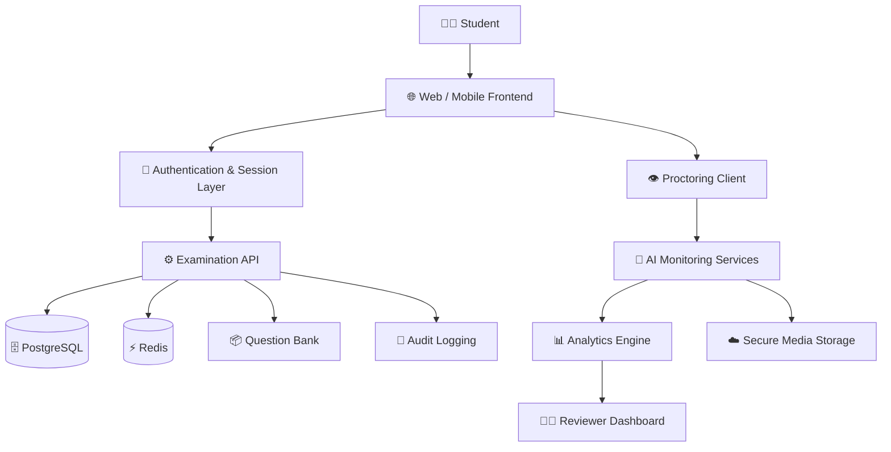

# 🛡️ Secure Online Examination System

> 🎓 A secure, scalable, and intelligent online examination platform designed to minimize cheating, detect suspicious activity, protect exam integrity, and provide a fair testing experience.

---

## 🚀 Overview

The **Secure Online Examination System** is designed to deliver reliable online assessments with a multi-layered security approach. Instead of relying on a single anti-cheating mechanism, the platform combines secure exam design, identity verification, AI-assisted proctoring, browser monitoring, backend security, and post-exam analytics.

The goal is to make cheating more difficult, suspicious activity detectable, and examinations fair for everyone.

## ✨ Key Features

### 📝 Smart Examination System
- 🎲 Randomized question selection from a large question bank.
- 🔀 Randomized question and answer option ordering.
- 🧮 Parameterized questions with unique values per student.
- ⏱️ Per-question timers and configurable exam duration.
- 🚫 Optional restrictions on revisiting answered questions.
- 🧠 Application-based questions to reduce search-based cheating.
- 🎯 Unique question sets for individual candidates.
- 💾 Automatic answer saving and recovery.

### 🔐 Identity Verification
- 📲 OTP and SSO authentication.
- 👤 Facial verification before starting the examination.
- 🛡️ Liveness detection to reduce photo-based spoofing.
- 🔄 Periodic identity re-verification.
- 💻 Device and session binding.
- 🚷 Single active session per candidate.
- ⌨️ Optional behavioral pattern monitoring.

### 👁️ AI-Assisted Proctoring
- 📷 Webcam monitoring.
- 🎙️ Microphone monitoring.
- 👥 Multiple-face detection.
- 🚫 Face absence detection.
- 👀 Suspicious gaze and movement signals.
- 🔊 Audio activity monitoring.
- 📱 Optional secondary camera monitoring.
- 🎥 Exam session recording.
- 🤖 AI-assisted suspicious activity detection.
- 🧑‍⚖️ Human review before disciplinary decisions.

### 🖥️ Exam Environment Security
- 🔒 Fullscreen exam mode.
- 📑 Tab-switch detection.
- 🪟 Window-focus monitoring.
- 📋 Copy, paste and clipboard activity monitoring.
- 🖥️ Multiple display detection signals.
- 🚧 Restricted navigation during examinations.
- 🛡️ Optional secure desktop client or kiosk mode.
- ⚠️ Detection signals for remote access and virtual environments where technically supported.

> Browser-based restrictions are treated as monitoring signals, not absolute guarantees.

### 🔒 Backend & Infrastructure Security
- 🔐 Server-side answer validation.
- ⏳ Server-controlled timers.
- 🛡️ Short-lived authentication tokens.
- 🚦 Rate limiting and request throttling.
- 🌐 WAF and DDoS protection.
- 🔏 Encrypted question banks and sensitive data.
- 🧑‍💼 Role-based access control (RBAC).
- 🧾 Immutable audit logs.
- 🛡️ Protection against SQL Injection, XSS, CSRF and IDOR.
- 🔍 OWASP ASVS-inspired security practices.
- 🧪 Third-party security testing before production deployment.

### 📊 Post-Exam Analytics
- 📈 Student performance analytics.
- 🔍 Identical answer-pattern detection.
- ⚡ Unusually fast response detection.
- 🧩 Answer similarity analysis.
- 🌐 IP and device-related anomaly signals.
- 🚩 Suspicious activity reports.
- 📋 Review queue for flagged examinations.
- 🧑‍⚖️ Human verification before final decisions.

### 🧑‍💻 Admin & Reviewer Dashboard
- 👨‍🏫 Teacher and administrator management.
- 📝 Question bank management.
- 🎓 Student management.
- 📅 Exam scheduling.
- 📊 Results and performance reports.
- 🚩 Suspicious activity review.
- 🎥 Recorded session review.
- 🧾 Audit log viewer.
- ⚙️ Exam configuration and security settings.

---

## 🏗️ System Architecture



## 🛠️ Recommended Technology Stack

| Layer | Technologies |
|---|---|
| 🌐 Frontend | React / Next.js |
| 📱 Mobile | Flutter / Android |
| ⚙️ Backend | Node.js / Django / Spring Boot |
| 🗄️ Database | PostgreSQL |
| ⚡ Cache & Sessions | Redis |
| 🔄 Real-time | WebSockets |
| 🤖 AI Services | Python, OpenCV, ML services |
| 🎥 Media Storage | S3-compatible object storage |
| 📨 Job Queue | BullMQ / Celery |
| 🔐 Authentication | JWT / OAuth 2.0 / SSO |
| 🌍 Infrastructure | Docker / Cloud infrastructure |
| 🛡️ Security | OWASP ASVS / WAF |

---

## 🔄 Examination Workflow

1. 🔐 Student authenticates using OTP, SSO or credentials.
2. 👤 Identity verification is performed.
3. 📋 Exam instructions and privacy notices are displayed.
4. 🎥 Proctoring permissions are requested where applicable.
5. 📝 A randomized examination paper is generated.
6. ⏱️ The server starts the examination timer.
7. 💾 Answers are automatically saved.
8. 👁️ Monitoring signals are recorded during the exam.
9. 📤 Examination submission is completed.
10. 📊 Results and analytics are processed.
11. 🚩 Suspicious activity is reviewed by authorized reviewers.

---

## 🛡️ Security Philosophy

This platform follows a **defense-in-depth** security model.

| Security Layer | Purpose |
|---|---|
| 📝 Exam Design | Reduce the usefulness of cheating |
| 👤 Identity | Verify the candidate |
| 👁️ Monitoring | Detect suspicious behavior |
| 🖥️ Client Security | Restrict and monitor exam environment |
| 🔒 Backend Security | Protect examination data |
| 📊 Analytics | Identify anomalies |
| 🧑‍⚖️ Human Review | Ensure fair decisions |

No single security mechanism is considered completely reliable. Suspicious signals should be reviewed alongside contextual evidence.

---

## 🔏 Privacy & Fairness

Privacy and fairness are fundamental parts of the system.

- 🔐 Secure storage of sensitive information.
- 📋 Clear consent and privacy notices.
- ⏳ Defined retention periods for recordings.
- 🧑‍⚖️ Human review of suspicious activity.
- ⚖️ Fair appeals and dispute resolution.
- ♿ Accessibility support.
- 🚫 No automatic disqualification based solely on AI flags.
- 🛡️ Data minimization and controlled access.

---

## 📂 Project Structure

```text
secure-exam-system/
│
├── frontend/               # Student and admin interfaces
├── backend/                # REST APIs and exam services
├── proctoring/             # Monitoring and proctoring services
├── ai-services/             # AI-assisted analysis
├── reviewer-dashboard/      # Flagged session review
├── database/                # Schemas and migrations
├── infrastructure/          # Docker and deployment
├── documentation/            # Architecture and API docs
├── tests/                    # Automated testing
└── README.md
```

---

## 📌 Development Roadmap

- [ ] 🔐 Authentication and user management
- [ ] 👨‍🎓 Student dashboard
- [ ] 👨‍🏫 Admin and teacher dashboard
- [ ] 📝 Question bank
- [ ] 🎲 Randomized exam generation
- [ ] ⏱️ Server-side examination timer
- [ ] 💾 Auto-save and recovery
- [ ] 🔄 Real-time session monitoring
- [ ] 👁️ Webcam-based proctoring
- [ ] 👤 Facial verification and liveness checks
- [ ] 🖥️ Browser activity monitoring
- [ ] 🚩 Suspicious activity detection
- [ ] 📊 Analytics dashboard
- [ ] 🧑‍⚖️ Human review system
- [ ] 🔒 Security testing
- [ ] ☁️ Production deployment

---

## ⚠️ Disclaimer

This project aims to improve online examination security, integrity, and fairness.

No online examination system can guarantee 100% prevention of cheating. Detection systems may produce false positives and false negatives. Monitoring features should be implemented transparently, responsibly, and in compliance with applicable laws and privacy requirements.

---

## 🤝 Contributing

Contributions, ideas, bug reports, and feature suggestions are welcome!

1. 🍴 Fork the repository.
2. 🌿 Create a new feature branch.
3. 💻 Make your changes.
4. 🧪 Test your implementation.
5. 📩 Submit a Pull Request.

---

## 📜 License

This project is distributed under a license to be specified by the repository owner.

---

<p align="center">
  🔐 <b>Secure Exams. Fair Assessments. Smarter Education.</b> 🎓
</p>

